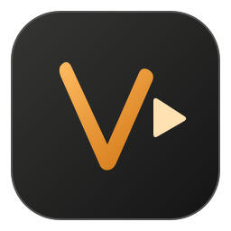
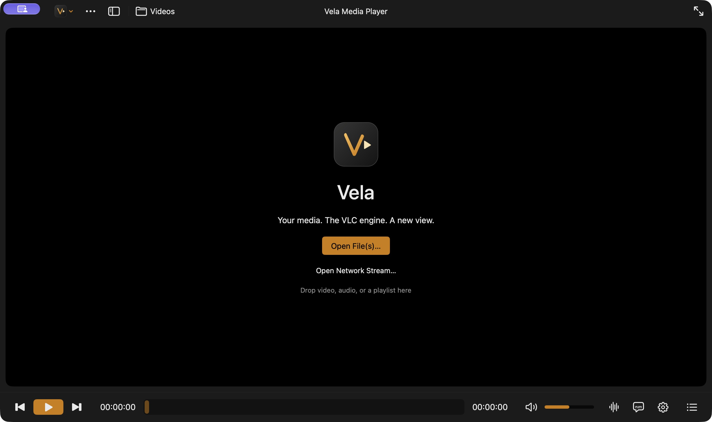

<p align="center"></p>
<h1 align="center">Vela</h1>
<p align="center">A native macOS media player powered by the VLC engine.</p>
<p align="center">
<a href="https://github.com/HosseinFazlabadi/Vela/releases"></a>
<a href="https://github.com/HosseinFazlabadi/Vela/actions/workflows/ci.yml"></a>


<a href="LICENSE.txt"></a>
</p>

Vela brings file and network playback, an independent media library, capture, conversion, streaming, and Lua extensions into a native SwiftUI and AppKit interface. It bundles libVLC, so you do not need to install or open VLC to use a release build.



## Download and install

1. Download **Vela-1.1-macOS.zip** from the [latest release](https://github.com/HosseinFazlabadi/Vela/releases/latest).
2. Expand the archive and drag **Vela.app** to **Applications**.
3. Open Vela and select a file, drag media into the window, or use **File → Open Network Stream**.

**Requirements:** Apple Silicon (M1 or newer), macOS 26 or later. Intel Macs are not supported by this release.

The current release is locally signed and is **not notarized by Apple**. If macOS blocks it, check that you downloaded it from this repository, try opening the app, then use **System Settings → Privacy & Security → Open Anyway** for Vela. Do not disable macOS security protections globally. SHA-256 checksums are attached to the release.

## What you can do

| Area | Features |
| --- | --- |
| Playback | File, folder and network input; audio, video and subtitle tracks; seeking, speed, frame stepping and chapters |
| Library | A persistent media library independent of history; queues, saved playlists, resume positions and bookmarks |
| Audio and video | Output devices, equalizer, timing adjustments, aspect, crop, deinterlacing and image adjustments |
| Capture | Camera and microphone inputs, screen capture with optional system audio, and a generated test pattern |
| Export | Video/audio conversion, recording and HTTP/UDP/RTP streaming |
| Discs and renderers | Disc dialogs, title/chapter/menu controls, renderer discovery and output switching |
| Extensions | Lua source, compatible bytecode, VLE packages and module folders; all extension windows use Vela's native interface |

See the [user guide](docs/USER-GUIDE.md) for controls and workflows, and the [extension API](EXTENSION-API.md) for compatibility details.

## Build from source

You need Xcode, Python 3, FFmpeg, and the official **VLC 3.0.24 Apple Silicon** app. The extension bridge uses a pinned private ABI; a different VLC version will be rejected.

```sh
git clone https://github.com/HosseinFazlabadi/Vela.git
cd Vela
./build.sh
open dist/Vela.app
```

Set `VELA_VLC_APP` if VLC is installed elsewhere, or `VELA_OUTPUT_DIR` to change the output directory. The build bundles and relocates FFmpeg and its libraries, builds the extension bridge, and locally signs the app. It does not download packages or modify your installed VLC.

```sh
python3 Tests/fetch-compatibility-fixtures.py
Tests/run.sh
```

The integration suite additionally requires `dvdauthor`. Optional third-party fixture downloads are pinned by commit and checksum. Tests use separate application data and extension paths. CI checks source syntax, API inventory and repository hygiene; device integration is tested separately. See [CONTRIBUTING.md](CONTRIBUTING.md).

## Release status

The 1.1 engine passed **117 software integration checks** on Apple Silicon, including a second run against the extracted release archive. Eight media outputs were independently decoded. Public builds also undergo validation after packaging. Version-specific results are attached to each release; see [verification notes](docs/VERIFICATION.md).

This release is not a claim of complete parity with every VLC interface feature or compatibility with every third-party extension. Online subtitle services, physical disc drives and casting/capture hardware are not certified by the software fixtures. Some uninterruptible native script operations can outlast execution deadlines. These limits are documented rather than hidden behind an unsupported compatibility claim.

## Contributing and future releases

Report reproducible problems through [Issues](https://github.com/HosseinFazlabadi/Vela/issues), discuss ideas in [Discussions](https://github.com/HosseinFazlabadi/Vela/discussions), or submit a pull request. The [roadmap](docs/ROADMAP.md) and [release guide](docs/RELEASING.md) describe the next steps and the process for publishing new versions.

## License and acknowledgements

Vela's source and adapted extension bindings are licensed under **GPL-2.0-or-later**. Dependencies retain their original licenses. The separate FFmpeg helper includes GPL-3.0-or-later components. Source archives and build provenance for distributed dependencies accompany releases; see [THIRD-PARTY-NOTICES.md](THIRD-PARTY-NOTICES.md) and [runtime sources](docs/RUNTIME-SOURCES.md).

Vela is an independent project and is not affiliated with VideoLAN. The interface was inspired by the [VLC Redesign community concept](https://www.figma.com/community/file/1691465999134370980/vlc-redesign). Public builds use macOS system symbols and Vela's original logo; exported community artwork is not distributed.
